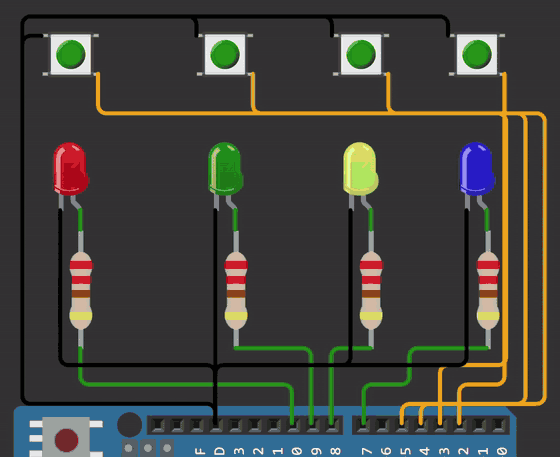
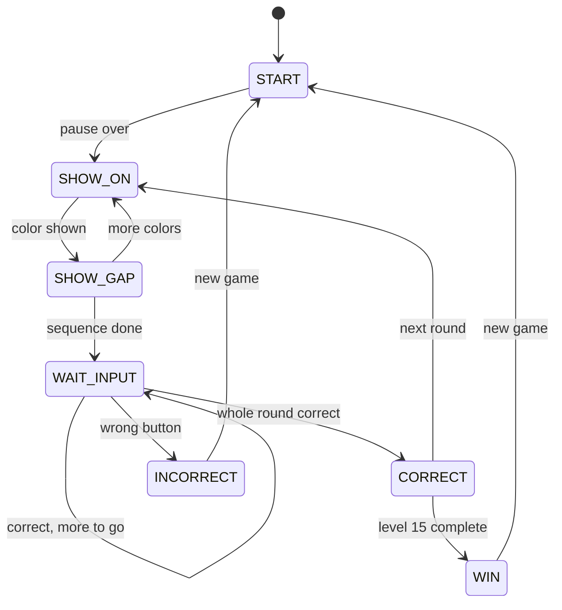

# Simon Says on Arduino

A Simon Says memory game for Arduino, written as a **non-blocking finite state machine**. The board plays a growing sequence of colored lights, and the player repeats it on four buttons. The firmware never calls `delay()`: every pass through `loop()` reads the buttons and advances the game using `millis()` timing, so it responds to input at any moment.

**[▶ Try it in your browser on Wokwi](https://wokwi.com/projects/480073055718248449)**, no hardware needed.

## Features

- **Non-blocking state machine:** seven states, all timed with `millis()`, with no `delay()` anywhere in the game logic
- **Software debouncing with edge detection:** each button's reading has to hold steady for 30 ms before it counts, and the game tracks the exact moment of each press and release
- **Release-to-answer input:** pressing a button lights its LED, and releasing it submits the answer, so holding a button can't count twice
- **15 levels:** the sequence grows by one random color each round, and completing all 15 wins the game
- **Distinct feedback:** one flash for a correct round, three quick flashes for a mistake, and a chase pattern around the LEDs for a win
- **Serial debug output** at 9600 baud, with an optional cheat mode that prints the sequence

## Hardware

| Part | Quantity |
|---|---|
| Arduino Uno (or compatible board) | 1 |
| LEDs: red, green, yellow, blue | 4 |
| Resistors for the LEDs (for example 220 Ω) | 4 |
| Push buttons | 4 |
| Breadboard and jumper wires | — |

### Wiring

| Color | LED pin | Button pin |
|---|---|---|
| Red | 10 | 5 |
| Green | 9 | 4 |
| Yellow | 8 | 3 |
| Blue | 7 | 2 |

- Each **LED** goes from its pin through a resistor to GND.
- Each **button** connects its pin to GND. The code uses the Arduino's internal pull-up resistors (`INPUT_PULLUP`), so no external resistors are needed and a pressed button reads LOW.
- Leave **A0** unconnected. Its electrical noise seeds the random number generator.

## How to play

1. Upload `Simon_Says/Simon_Says.ino` with the Arduino IDE, or open the [Wokwi simulation](https://wokwi.com/projects/480073055718248449) and press play.
2. The board shows the sequence, one color at a time.
3. Repeat it by pressing the matching buttons. Your answer counts when you release each button.
4. Get it right and all LEDs flash once, then the sequence grows by one color.
5. Make a mistake and the LEDs flash three times, then a new game starts.
6. Complete all 15 levels to see the win animation.

## How it works

### State machine

| State | What happens |
|---|---|
| `START` | Short pause before a new game's first color |
| `SHOW_ON` | The current color in the sequence is lit |
| `SHOW_GAP` | All LEDs off between colors |
| `WAIT_INPUT` | Waits for the player to press and release buttons |
| `CORRECT` | Pass flash, then the next round, or the win at level 15 |
| `INCORRECT` | Three quick flashes, then a new game |
| `WIN` | A light chase around all four LEDs three times, then a new game |

Every state change goes through one helper, `goTo()`, which restarts the state's timer. Each state then checks `timeUp(ms)` to decide when to move on, so the main loop never blocks.

### Debouncing and edge detection

`updateButtons()` runs at the start of every loop. For each button it:

1. Restarts a timer whenever the raw reading changes, whether from a real press or contact bounce.
2. Accepts the new state only once it has held steady for `DEBOUNCE_MS` (30 ms).
3. Reports the change as a **press** (up to down) or a **release** (down to up) for that one pass through the loop.

The game logic only ever sees clean, single press and release events.

### Settings

All timing values are constants at the top of the sketch, so the game's feel can be tuned in one place:

| Constant | Default | Meaning |
|---|---|---|
| `MAX_LEVEL` | 15 | Longest sequence; completing it wins |
| `SHOW_ON_MS` | 1000 | How long each color is lit during playback |
| `SHOW_GAP_MS` | 500 | Gap between colors during playback |
| `DEBOUNCE_MS` | 30 | How long a reading must hold to count |
| `DEBUG_SHOW_SEQUENCE` | false | `true` prints the sequence to Serial (cheat mode) |

### Serial output

Open the Serial Monitor at **9600 baud** to follow the game:

| Message | Meaning |
|---|---|
| `NEW GAME` | A new game started |
| `GY` / `GN` | The player pressed green, correctly (Y) or wrongly (N). Likewise R, Y, B for the other colors. |
| `Y` / `N` | The whole round passed or failed |
| `WIN` | All 15 levels completed |

## Files

| File | Description |
|---|---|
| `Simon_Says/Simon_Says.ino` | Complete sketch (the Arduino IDE expects it inside a folder with the same name) |
| `docs/demo.gif` | Recording of the game running in the Wokwi simulator |
